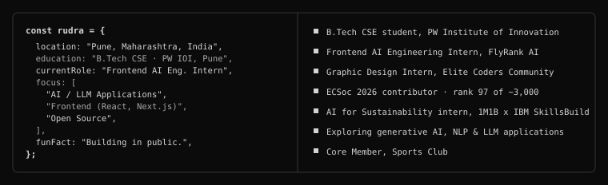
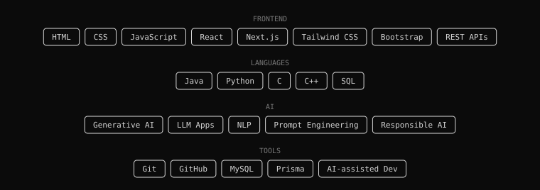
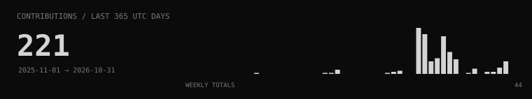
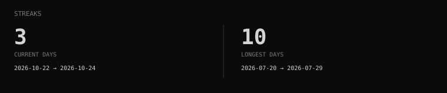
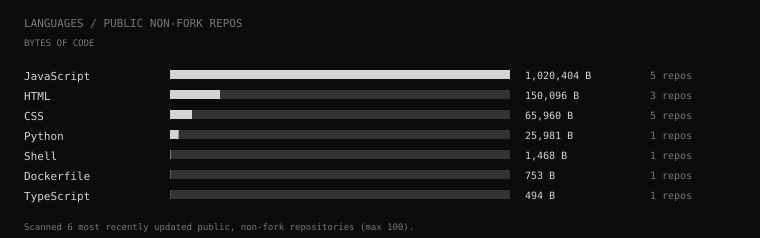
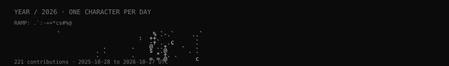

 

---

<h2 align="center">Profile</h2>

---

<h2 align="center">About Me</h2>

---

<h2 align="center">Tech Stack</h2>

---

<h2 align="center">Projects</h2>

| Project | What it does | Stack / Result |
| :--- | :--- | :--- |
| **Krishify AI** | AI-powered sustainable agricultural marketplace connecting farmers with verified buyers to cut post-harvest food loss | Next.js · Tailwind CSS · Prisma · MySQL |
| **CareQueue** | Smart healthcare queue management: symptom input, risk estimation, OPD tokens, severity-based prioritization | Top Finalist, ranked 5th, TCU Verse Hackathon |
| **VoteGenie** | AI-assisted first-time voter assistant with candidate comparison, built with accessibility and responsible AI in mind | AI · Accessibility · Security |
| **Nirogi-G1** | AI healthcare agent for conversational guidance and accessible user interaction | AI Agent |

---

<h2 align="center">GitHub Statistics</h2>

---

<h2 align="center">Contribution Activity</h2>

---

<h2 align="center">Open Source Contributions</h2>

| Program | Contribution | Result |
| :---: | :--- | :---: |
| **ECSoc 2026** | Raised 40+ pull requests; built backend/admin features: role management, session revocation, audit logging, automated tests | 35+ merged · Rank 97 of ~3,000 |

---

<h2 align="center">Contribution Snake</h2>

<picture>
  <source media="(prefers-color-scheme: dark)" srcset="https://raw.githubusercontent.com/rudraabhishek-collab/rudraabhishek-collab/output/github-snake-dark.svg" />
  
</picture>

---

`Building in public. Learning every day.`

